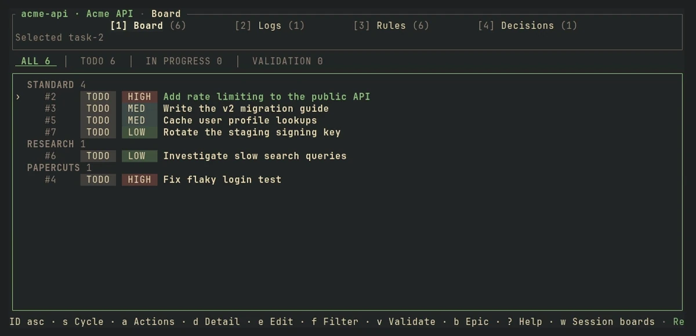
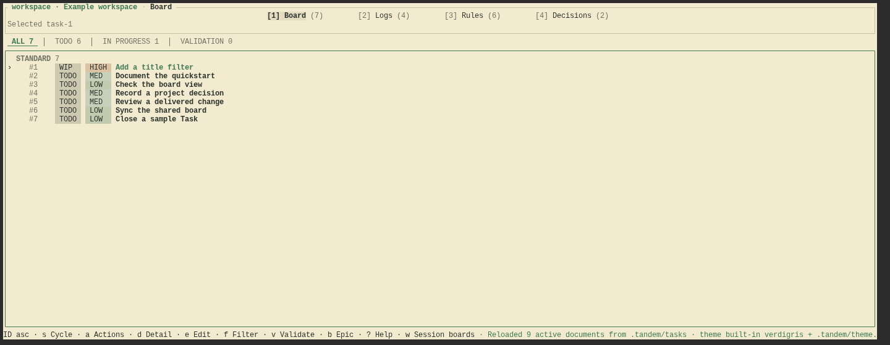
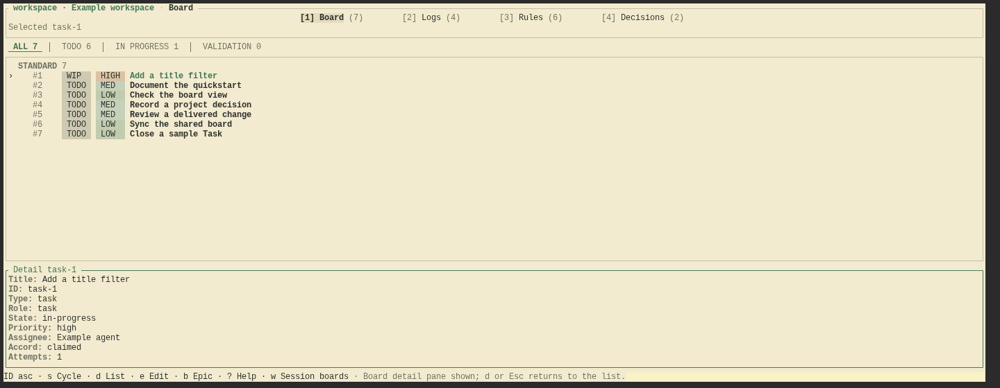
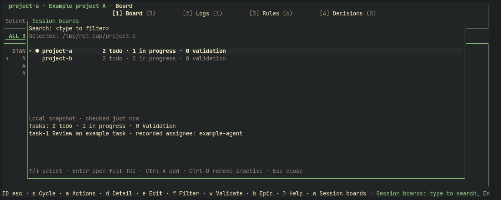

<picture>
  <source media="(prefers-color-scheme: dark)" srcset="site/public/banner-dark.svg">
  
</picture>

tandem is my local-first board for planning and delegating work between people and agents, stored as Markdown in the repository. It is a Rust CLI and TUI, the protocol the board follows, and the docs that explain both.

## Showcase



<table>
  <tr>
    <td width="33%">
      <picture>
        <source media="(prefers-color-scheme: dark)" srcset="site/public/images/homepage/board-dark-desktop.png">
        
      </picture>
      <br><sub>Board: Tasks by lane, state and priority</sub>
    </td>
    <td width="33%">
      <picture>
        <source media="(prefers-color-scheme: dark)" srcset="site/public/images/homepage/task-dark-desktop.png">
        
      </picture>
      <br><sub>Task detail: state, assignee and accord</sub>
    </td>
    <td width="33%">
      
      <br><sub>Session boards: switch between project boards</sub>
    </td>
  </tr>
</table>

## Install

```sh
curl -fsSL https://trytandem.dev/install.sh | sh
tandem --version
```

The installer is user-local and needs no `sudo`. With Rust, install from this repository:

```sh
cargo install --git https://github.com/Algorant/tandem.git --locked tandem
```

## How to use this repo

You don't need this repo to use tandem: install the release, then follow the [quickstart](https://trytandem.dev/quick-start/).

## Core

- **[protocol](protocol/README.md)** — the normative board format: Tasks, Decisions, Rules, Logs, Accords, and the event ledgers behind them
- **[tandem](tandem/README.md)** — the Rust CLI and TUI that read and write a `.tandem/` board, with the app and project layers underneath
- **[docs](docs/)** — the published source for [trytandem.dev](https://trytandem.dev/), built by [site](site/)

## Development

- `just dev` builds a release binary and opens a disposable Git-backed board
- `just dev-check` runs the native checks and a workflow smoke test
- `just site-build` builds the documentation site

## License

[MIT](LICENSE)
